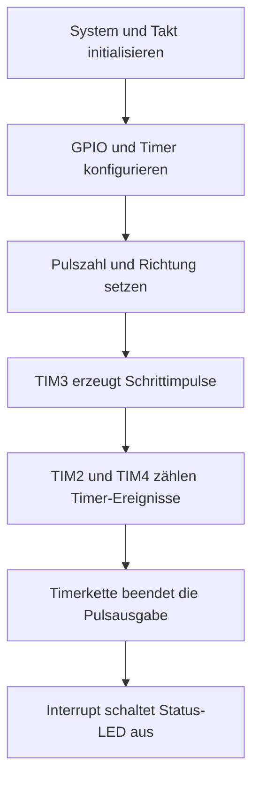

# STM32-Schrittmotorsteuerung

Registerbasierte Firmware für einen STM32F103C8 zur Erzeugung einer vorgegebenen
Anzahl von Schrittimpulsen. Drei gekoppelte Timer steuern Pulsausgabe,
Pulszählung und das Ende einer Bewegung. Ein zusätzlicher GPIO legt das
Richtungssignal für einen externen Motortreiber fest.

## Funktionen

- Bewegungsstart mit Pulszahl, Geschwindigkeitsparameter und Richtung.
- Pulsausgabe über TIM3; Zählung über TIM2 und TIM4.
- Abschlussmeldung über einen Timer-Interrupt und eine Status-LED.
- Direkte Registerzugriffe mit CMSIS-Headern.

## Hardware und Signale

| Bestandteil | Verwendung im Code |
|---|---|
| Mikrocontroller | STM32F103C8Tx laut IDE-Projekt |
| PB4 | Pulsausgang über TIM3 mit partiellem Remapping |
| PB5 | Richtungsausgang |
| PC13 | Status-LED, im Code aktiv bei Low |
| Takt | Initialisierung für HSE und PLL; `SystemCoreClock` ist auf 72 MHz gesetzt |

Die GPIO-Signale sind für die Steuereingänge eines externen Motortreibers
vorgesehen. Motortreiber, Motorversorgung, Masseverbindung und zulässige
Signalpegel müssen zum tatsächlichen Aufbau passen. Die Pinbelegung steht
ausführlicher in der [Hardwarebeschreibung](docs/HARDWARE.md).

## Anwendungsbeispiel

`main.c` initialisiert System und Timer und startet einmalig:

```c
stepper_start(9600, 50, __DIR_CW);
```

| Parameter | Bedeutung |
|---|---|
| `9600` | Angeforderte Anzahl der Schrittimpulse |
| `50` | Geschwindigkeitsparameter für die Prescaler-Berechnung |
| `__DIR_CW` | Im Code definierter Richtungswert; setzt PB5 auf High |

Der zweite Parameter heißt im Quelltext `RPM`. Eine tatsächliche Drehzahl
ist damit noch nicht nachgewiesen: Sie hängt unter anderem von Takt,
Schrittwinkel und Mikroschritteinstellung ab und muss gemessen werden.

## Programmablauf



## Projektstruktur

| Pfad | Inhalt |
|---|---|
| `firmware/stepperv4/Core/Src/main.c` | Einstieg und Demonstrationsbewegung |
| `firmware/stepperv4/lib/stepper.c` | Timerkopplung, Pulsvorgabe und Richtung |
| `firmware/stepperv4/Core/Src/system.c` | System- und Taktinitialisierung |
| `firmware/stepperv4/Core/Src/it.c` | Interrupt-Verarbeitung |
| `firmware/stepperv4/CMSIS/` | Mitgelieferte Geräte- und Prozessorheader |
| `tools/build.py` | Build ohne IDE |
| [Prüfplan](docs/PRUEFPLAN.md) | Vorgesehene Messungen und bekannte Grenzen |

## Bauen

### Mit Python und Arm-GCC

Python 3 und `arm-none-eabi-gcc` mit Newlib/Nano-Specs bereitstellen.
Der Compiler muss im PATH liegen; alternativ kann `ARM_GCC` auf die
Compilerdatei gesetzt werden. Im Repository-Verzeichnis ausführen:

```powershell
python tools/build.py --profile Debug
python tools/build.py --profile Release
```

Die Ausgabe liegt unter `build/<Profil>/firmware.elf` und ist durch
`.gitignore` ausgeschlossen.

### Mit STM32CubeIDE

`firmware/stepperv4` als bestehendes Projekt importieren und den internen
Projektnamen `stepperv4` beibehalten. Include-Pfade und Quellordner sind für
Debug und Release auf die mitgelieferte Ordnerstruktur eingestellt.
Ein vollständiger IDE-Import muss am eigenen Rechner geprüft werden.

## Entwicklungs- und Prüfstand

Die Firmware startet eine feste Demonstrationsbewegung. Beschleunigungsrampe,
Freigabeprüfung bei bereits laufender Bewegung und Plausibilitätsprüfung der
Geschwindigkeitsvorgabe sind noch nicht implementiert.

Das enthaltene Drehgeber-Modul `rotary.c` wird in `main.c` nicht aktiviert.
Es verwendet ebenfalls TIM4 und darf nicht unverändert parallel zur
Schrittmotorsteuerung eingesetzt werden.

Pulszahl, Frequenz, Richtungswechsel und Bewegungsende sind am tatsächlichen
Aufbau zu messen. Der [Prüfplan](docs/PRUEFPLAN.md) enthält die vorgesehenen Fälle.
Debug und Release wurden mit Arm-GCC 12.3.1 kompiliert und gelinkt. In beiden
Profilen bleibt eine Linkerwarnung zum RWX-Speichersegment. Details stehen in
[BUILD_STATUS.txt](BUILD_STATUS.txt).
